# NEURA-32 Vigía: vigilancia perimetral inteligente sobre el RISC-V de la clase

**Laboratorio de Arquitecturas Computacionales (LA116) · Proyecto final**
**Equipo:** Roberto Orozco Ramírez (ID 184595) · Adam Del Pozo Ontiveros (ID 185611)
**Plataforma:** Verilog-2005 · Icarus Verilog y Active-HDL · Quartus Prime 24.1 Lite · DE10-Lite (MAX 10 10M50DAF484C7G) · cámara OV7670 · monitor VGA

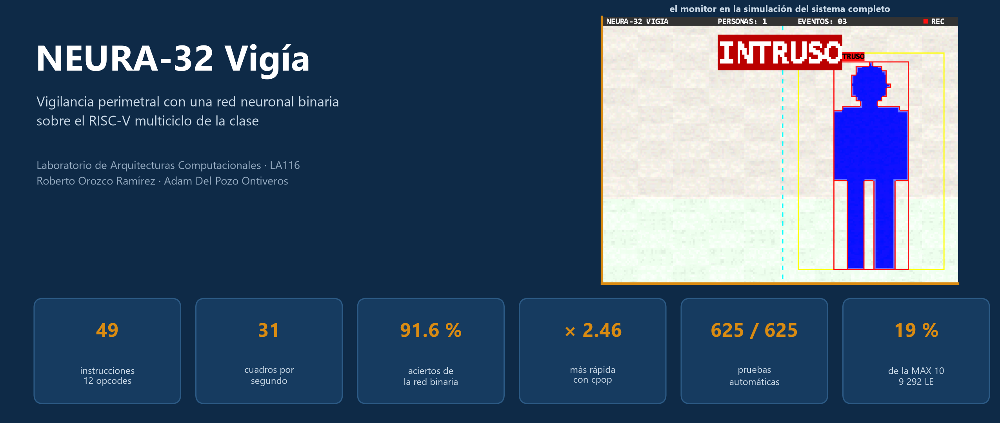

**Contenido:** [1. Problema](#1-planteamiento-del-problema-y-justificación) ·
[2. Del RISC-V de la clase a NEURA-32](#2-del-risc-v-de-la-clase-a-neura-32-paso-a-paso) ·
[3. Visión](#3-la-visión-hardware-sin-procesador) · [4. Programa de vigilancia](#4-el-programa-de-vigilancia) ·
[5. Verificación](#5-verificación) · [6. Recursos y rendimiento](#6-mediciones-de-recursos-y-rendimiento) ·
[7. Conclusiones](#7-conclusiones-y-trabajo-futuro) · [Cómo se usa](#cómo-se-usa)

---

## 1. Planteamiento del problema y justificación

Las cámaras de vigilancia comerciales avisan cuando «algo se mueve». La mayoría de esas alarmas son falsas:
una sombra, un cambio de luz, una mascota. Los equipos de gama alta lo resuelven con un clasificador que
decide si lo que se mueve es una persona antes de avisar (intrusión en zona y cruce de línea con filtro de
personas).

Este proyecto construye esa función completa sobre **el procesador RISC-V multiciclo que se armó en clase**
(`riscv_ab_c`, el que calcula `(a + b) · c`), ampliado paso a paso hasta poder correr el programa de
vigilancia:

* una cámara OV7670 mira una puerta o un pasillo y el monitor VGA muestra el video a color;
* el hardware separa lo que se mueve del fondo y entrega la **silueta** de cada objeto;
* el procesador etiqueta cada silueta, la recorta y la pasa por una **red neuronal binaria** que decide si es
  **persona** (de cuerpo completo, de medio cuerpo o solo el busto), **objeto o animal**, o **ruido**;
* solo si es una persona aplica las **reglas perimetrales**: entrar a una zona prohibida y quedarse, o cruzar
  una línea virtual en el sentido prohibido. Entonces enciende la alarma, pinta el recuadro en rojo con el
  letrero «INTRUSO» y cuenta entradas y salidas en los displays.

Todo está escrito en Verilog: el procesador, la visión, el monitor y también el ensamblador con el que se
escriben los programas.

## 2. Del RISC-V de la clase a NEURA-32, paso a paso

### 2.1 Punto de partida: `riscv_ab_c`

Los archivos de la clase están sin tocar en [`docs/base-clase/`](docs/base-clase): `riscv_ab_c.v`,
`uc_simple.v`, `alu_riscv.v`, `decoder.v`, `regfile.v`, `pipo_register.v`, `rom.v`, `ram.v` y
`programa_ab_c.txt`.

```
            ┌──────────────── uc_simple (máquina de estados) ────────────────┐
            │  FETCH → DECODE → EXEC_R / EXEC_MUL → WRITEBACK                 │
            │                 → MEM_ADDR → MEM_READ / MEM_WRITE               │
            └── pc_en · alu_src · alu_op · mem_read · mem_write · reg_write ──┘
  ┌────┐   ┌──────┐   ┌────┐   ┌─────┐   ┌─────────┐   ┌─────┐   ┌──────┐
  │ PC ├──►│ IMEM ├──►│ IR ├──►│ DEC ├──►│   RF    ├──►│ ALU ├──►│ DMEM │
  └────┘   │ rom  │   └────┘   └─────┘   │ regfile │   └──┬──┘   │ ram  │
   PC + 4  └──────┘                      └────▲────┘      │      └──┬───┘
                                              └── wdata ◄─┴─────────┘
```

Es un procesador **multiciclo**: cada instrucción pasa por varias fases y una máquina de estados prende las
señales de cada fase. Su programa son dos instrucciones leídas de un archivo de texto en hexadecimal:

```
00208233      add x4, x1, x2      x4 = a + b
023212B3      mul x5, x4, x3      x5 = (a + b) · c
```

Lo que **no** podía hacer: saltar, llamar subrutinas, cargar constantes, leer o escribir bytes, dividir,
hablar con el exterior, ni usar más de las 8 operaciones que caben en `alu_op`.

### 2.2 Las reglas que se respetaron

1. **El formato de las instrucciones no cambia.** Todas miden 32 bits y los campos están siempre en el mismo
   lugar, que es lo que separa el `decoder` de la clase:

   ```
    31        25 24     20 19     15 14      12 11      7 6          0
   ┌────────────┬─────────┬─────────┬──────────┬─────────┬────────────┐
   │ funct7 (7) │ rs2 (5) │ rs1 (5) │ funct3(3)│ rd (5)  │ opcode (7) │  tipo R
   ├────────────┴─────────┼─────────┼──────────┼─────────┼────────────┤
   │ inmediato (12)       │ rs1     │ funct3   │ rd      │ opcode     │  tipo I (y cargas)
   ├────────────┬─────────┼─────────┼──────────┼─────────┼────────────┤
   │ inm[11:5]  │ rs2     │ rs1     │ funct3   │ inm[4:0]│ opcode     │  tipo S (almacenar)
   │ inm[12|10:5]│ rs2    │ rs1     │ funct3   │inm[4:1|11]│ opcode   │  tipo B (saltos)
   ├────────────┴─────────┴─────────┴──────────┼─────────┼────────────┤
   │ inmediato (20)                            │ rd      │ opcode     │  tipos U y J
   └───────────────────────────────────────────┴─────────┴────────────┘
   ```

2. **`funct3` siempre mide 3 bits** y es directamente la operación de la ALU (`alu_op = funct3`): 8
   operaciones por tabla.
3. **Para tener más de 8 operaciones no se alarga `funct3`: se agregan opcodes del mismo tipo.** Las
   instrucciones tipo R tienen tres opcodes (`OP_R1`, `OP_R2`, `OP_R3`) y las tipo I dos (`OP_I1`, `OP_I2`).
   El campo `funct7` conserva sus 7 bits en el formato, pero el procesador no lo necesita para decidir.
4. **Mismos bloques y mismos nombres que la base:** `PC`, `IMEM`, `IR`, `DEC`, `UC`, `RF`, `ALU` y `DMEM`,
   hechos con `pipo_register`, `rom`, `ram`, `regfile` y `decoder`. Reinicio asíncrono activo en bajo, como en
   clase.
5. **Las instrucciones del programa vienen de un `.txt` en hexadecimal**, una por renglón, que la memoria de
   programa lee con `$readmemh` igual que `programa_ab_c.txt`.
6. **Solo existe lo que algún programa del proyecto usa.** No hay instrucciones ni bloques de adorno.

### 2.3 Las etapas


<p align="center">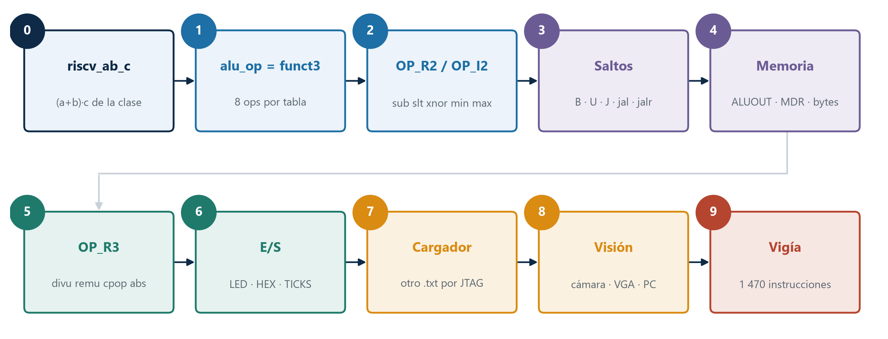</p>

*Las diez etapas, del procesador de la clase al sistema de vigilancia. Cada una agrega solo lo que algún programa usa.*

| Etapa | Qué se le agregó a la base | Dónde | Prueba que lo demuestra |
|---|---|---|---|
| 0 | Nada: el programa `(a + b) · c` de la clase corre igual en el procesador final | `riscv_neura.v` | `tb_programa_ab_c` |
| 1 | `alu_op = funct3` y `case (opcode)` en la ALU: las 8 operaciones de la clase ya se pueden pedir desde una instrucción (`OP_R1`) y con inmediato (`OP_I1`) | `alu_riscv.v`, `uc_simple.v` | `tb_uc_simple`, `tb_prueba_isa` |
| 2 | Segunda tabla tipo R (`OP_R2`, `OP_I2`): `sub slt sltu sra xnor min minu max` | `alu_riscv.v` | `tb_prueba_isa` |
| 3 | Saltos: inmediatos S, B, U y J en el decodificador, estados `EXEC_BR` y `JUMP_WAIT`, `lui`, `jal`, `jalr` y los seis saltos condicionales | `decoder.v`, `uc_simple.v`, `riscv_neura.v` | `tb_uc_simple`, `tb_prueba_isa` |
| 4 | Memoria: registros `ALUOUT` y `MDR`, RAM por bytes (`lb lh lbu lhu sb sh`) con cuatro `ram` de la clase y lectura de tablas desde la memoria de programa | `riscv_neura.v` | `tb_prueba_isa` |
| 5 | Tercera tabla tipo R (`OP_R3`): `divu` y `remu` con un divisor de varios ciclos (estado `EXEC_DIV`) y `cpop abs sgt clamp` para la red neuronal | `alu_riscv.v`, `divider.v`, `uc_simple.v` | `tb_prueba_isa`, `tb_red_neuronal` |
| 6 | Entradas y salidas mapeadas en memoria (LED, interruptores, displays, botones, contador de ciclos), `ecall` para detenerse (estado `HALT`) y memoria de programa de 4096 instrucciones | `soc_neura32.v`, `perifericos.v` | `tb_red_neuronal` |
| 7 | Cargador de programas por el cable USB-Blaster: otro `.txt` sin volver a compilar | `jtag_loader.v`, `rom.v` | `tb_cargador` |
| 8 | Visión: cámara, fondo y máscara, monitor VGA y vista en la PC | `hdl/vision/` | `tb_vision` |
| 9 | El programa de vigilancia | `prog/programa_vigia.vh` | `tb_vigia` |

**Etapa 1. La ALU decide con el opcode y el `funct3`.** En la base, la unidad de control escogía la
operación (`ALU_ADD` o `ALU_MUL`) y la ALU ignoraba el opcode. Ahora la unidad de control pasa el `funct3`
tal cual y la ALU primero mira de qué tipo es la instrucción:

```verilog
always @(*) begin
    case(opcode)
        //---------------- tabla 1: la de la clase ----------------
        OP_R1, OP_I1: begin
            case(alu_op)                    // alu_op = funct3
                ALU_ADD: begin result = sum; carry_flag = sum_ext[32]; ovf_flag = ovf_add; end
                ALU_MUL: result = mul_out;
                ALU_AND: result = A & B;
                ...
            endcase
        end
        //---------------- tabla 2 ----------------
        OP_R2, OP_I2: begin
            case(alu_op)
                ALU_SUB: begin result = sub; carry_flag = sub_ext[32]; ovf_flag = ovf_sub; end
                ALU_SLT: result = lt_s ? 32'd1 : 32'd0;
                ...
```

**Etapa 3. Saltos.** El `decoder` de la clase solo sacaba `imm_i`; se le agregaron `imm_s`, `imm_b`, `imm_u`
e `imm_j`. Como el PC ya avanzó cuando la instrucción está en `IR`, un registro nuevo (`PCI`) guarda el PC de
la instrucción para calcular el destino. En `EXEC_BR` la ALU compara `rs1` con `rs2` (entrega 1 si el salto
se cumple) y, si el PC cambia, `JUMP_WAIT` deja un ciclo para que la memoria de programa lea el destino.

**Etapa 4. Memoria.** El resultado de la ALU y el dato leído ahora se guardan en dos `pipo_register`
(`ALUOUT` y `MDR`), así la escritura al banco de registros usa valores que ya no cambian. La RAM de datos
son cuatro `ram` de la clase de 8 bits, una por byte, para poder escribir un solo byte (`sb`) o media
palabra (`sh`) y para que Quartus las coloque en bloques M9K.

**Etapa 5. División y la red neuronal.** Un divisor de 32 bits no cabe en un ciclo de 40 ns, así que
`divider.v` divide con restas y corrimientos, un bit por ciclo, y la unidad de control espera en
`EXEC_DIV` hasta que avisa `ready`. `cpop` (cuenta los bits en 1) se resuelve dentro de la ALU con un árbol
de sumas; junto con `xnor` es toda la aritmética de una neurona binaria.

### 2.4 Repertorio de instrucciones

`alu_op` es el `funct3` de la instrucción. La tabla la escoge el opcode:

| `funct3` | `OP_R1` / `OP_I1` (la de la clase) | `OP_R2` / `OP_I2` | `OP_R3` | `OP_BRANCH` |
|---|---|---|---|---|
| `000` | `add` | `sub` | `divu` (divisor) | `beq` |
| `001` | `mul` | `slt` | `remu` (divisor) | `bne` |
| `010` | `and` | `sltu` | `cpop` | |
| `011` | `or` | `sra` | `abs` | |
| `100` | `xor` | `xnor` | `sgt` | `blt` |
| `101` | `nota` (~A) | `min` | `clamp` | `bge` |
| `110` | `sll` | `minu` | | `bltu` |
| `111` | `srl` | `max` | | `bgeu` |

| Opcode | Valor | Instrucciones |
|---|---|---|
| `OP_R1` | `0110011` | tabla 1 entre dos registros |
| `OP_R2` | `0111011` | tabla 2 entre dos registros |
| `OP_R3` | `1011011` | tabla 3 |
| `OP_I1` | `0010011` | tabla 1 con inmediato: `addi andi ori xori slli srli` |
| `OP_I2` | `0011011` | tabla 2 con inmediato: `slti sltiu srai` |
| `OP_LOAD` | `0000011` | `lb lh lw lbu lhu` (el `funct3` dice el tamaño y el signo) |
| `OP_STORE` | `0100011` | `sb sh sw` |
| `OP_BRANCH` | `1100011` | `beq bne blt bge bltu bgeu` |
| `OP_LUI` | `0110111` | `lui` |
| `OP_JAL` / `OP_JALR` | `1101111` / `1100111` | `jal`, `jalr` (subrutinas) |
| `OP_SYSTEM` | `1110011` | `ecall` (fin del programa) |

Son **49 instrucciones** con 12 opcodes. `OP_R1` es exactamente la tabla de la clase y por eso
`programa_ab_c.txt` corre sin cambiarle un bit.

<p align="center">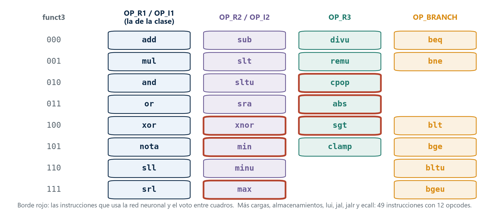</p>

*Las cuatro tablas de 8 operaciones: el opcode escoge la tabla y el `funct3` la operación.*

### 2.5 La unidad de control

```
                       ┌──────────────────────────────────────────────────────────┐
                       ▼                                                          │
   reset ──► FETCH ──► DECODE ──┬─ R1 R2 R3 I1 I2 lui ──► EXEC_R ─────────────► WRITEBACK
                                ├─ divu remu ───────────► EXEC_DIV (espera) ──► WRITEBACK
                                ├─ carga ──► MEM_ADDR ──► MEM_READ ───────────► WRITEBACK
                                ├─ almacenar ► MEM_ADDR ► MEM_WRITE ──► FETCH
                                ├─ saltos, jal, jalr ───► EXEC_BR ──┬─ no se cumple ──► FETCH
                                │                                   └─ PC nuevo ──► JUMP_WAIT ──► FETCH
                                └─ ecall ──► HALT
```

| Instrucción | Recorrido | Ciclos |
|---|---|---|
| tipo R, tipo I, `lui` | FETCH, DECODE, EXEC_R, WRITEBACK | 4 |
| carga | FETCH, DECODE, MEM_ADDR, MEM_READ, WRITEBACK | 5 |
| almacenamiento | FETCH, DECODE, MEM_ADDR, MEM_WRITE | 4 |
| salto que no se cumple | FETCH, DECODE, EXEC_BR | 3 |
| salto que se cumple, `jal`, `jalr` | FETCH, DECODE, EXEC_BR, JUMP_WAIT | 4 |
| `divu`, `remu` | FETCH, DECODE, EXEC_DIV (32 ciclos del divisor), WRITEBACK | 36 |

<p align="center">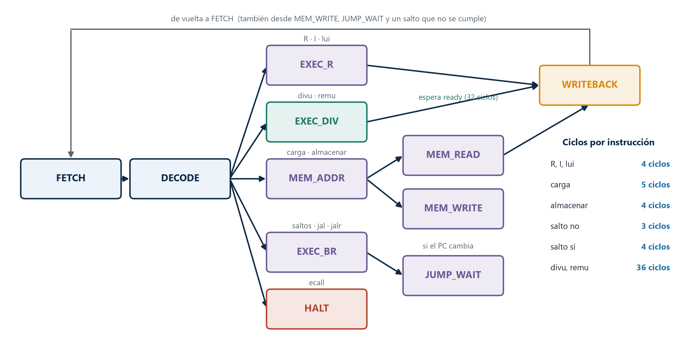</p>

*La máquina de estados de la unidad de control y los ciclos que tarda cada tipo de instrucción.*

<p align="center">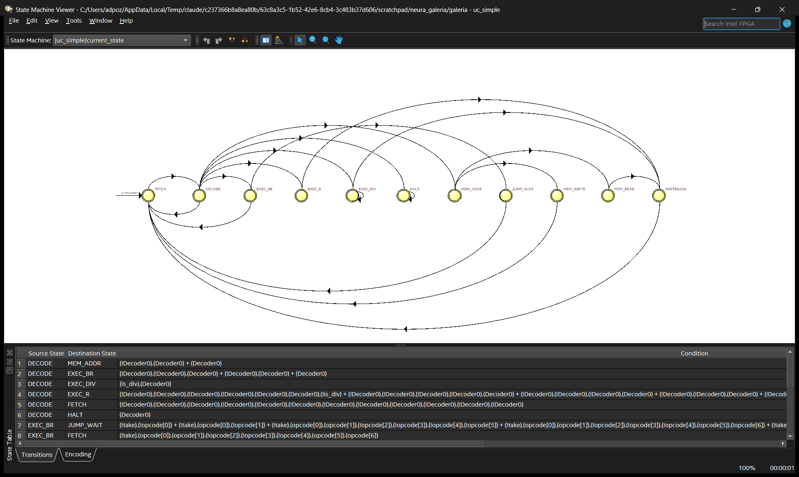</p>

*La misma máquina de estados como la reconoce Quartus (State Machine Viewer): los 11 estados de `current_state` y, abajo, la tabla de transiciones con la condición de cada una.*

<p align="center">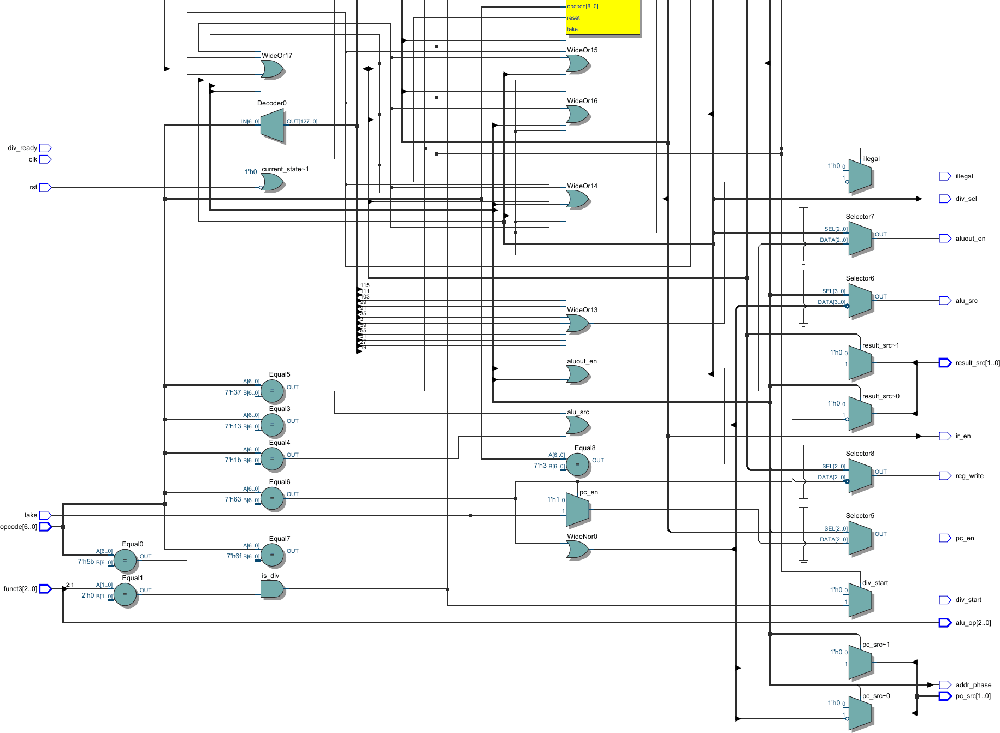</p>

*`uc_simple` en el RTL Viewer: la lógica que saca las señales de control a partir del estado (`pc_en`, `ir_en`, `alu_src`, `reg_write`, `result_src`, `pc_src`, `div_start`, …). Es una máquina de Moore: ninguna salida depende de la ALU en el mismo ciclo.*

Las salidas dependen solo del estado y de la instrucción que está en `IR` (máquina de Moore), igual que en
la `uc_simple` original. Las señales nuevas son `pc_src` (PC + 4, PC + inmediato o resultado de la ALU),
`result_src` de 2 bits (ALU, memoria o dirección de regreso), `ir_en`, `aluout_en`, `mdr_en`, `div_start`,
`div_sel`, `halted` e `illegal`.

### 2.6 El camino de datos final

```
                  ┌──────────────────────────── uc_simple ────────────────────────────┐
                  │ opcode, funct3 ──► estado ──► señales de control                  │
                  └─────────▲──────────────────────────────────────────────────────────┘
                            │ take (la ALU dice si el salto se cumple) · div_ready
 ┌────┐  ┌───────┐  ┌────┐  ┌─────┐  ┌─────────┐      ┌─────┐   ┌────────┐   ┌─────────────┐
 │ PC ├─►│ IMEM  ├─►│ IR ├─►│ DEC ├─►│   RF    ├─A───►│ ALU ├──►│ ALUOUT ├──►│ DMEM0..3    │
 └─▲──┘  │ 4096  │  └────┘  └──┬──┘  │ regfile ├─B─┬─►│     │   └───┬────┘   │ 4 × ram 8 b │
   │     │ instr.│  ┌────┐     │inm  └────▲────┘   │  └─────┘       │        └──────┬──────┘
   │     └───▲───┘  │PCI │     └──────────┼────────┘  ┌─────┐       │   entradas y  │
   │         │      └─┬──┘                │           │ DIV ├───────┤   salidas ◄───┤
   │  tablas y pesos  │ PC de la          │           └─────┘       │               ▼
   │  (lw desde 0x0…) │ instrucción       │                         │           ┌───────┐
   │                  ▼                   └──────── wdata ◄─────────┴───────────┤  MDR  │
   └── PC + 4 · PCI + inmediato · rs1 + inmediato                               └───────┘
```

<p align="center">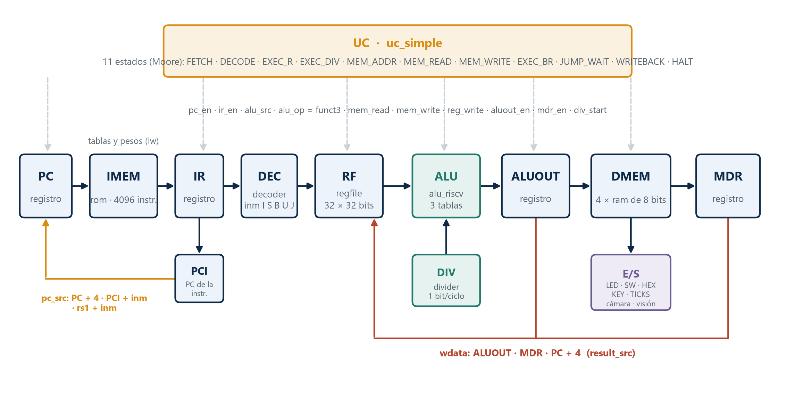</p>

*El camino de datos: los mismos bloques de la clase (azul), la ALU y el divisor (verde), las entradas y salidas (morado) y las dos rutas de regreso: `wdata` al banco de registros y `pc_src` al PC.*

#### El camino de datos en el RTL Viewer de Quartus

Así queda `riscv_neura` después de la síntesis. Los bloques verdes son las instancias de la clase (`pipo_register`,
`decoder`, `regfile`, `alu_riscv`, `ram`, `uc_simple`) y el divisor; los trapecios son los multiplexores que escogen de
dónde viene cada dato.

<p align="center">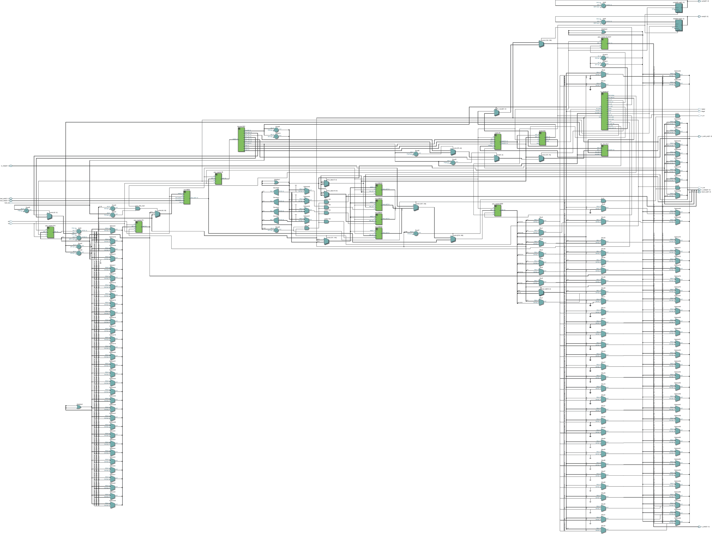</p>

*`riscv_neura` completo en el RTL Viewer.*

<p align="center">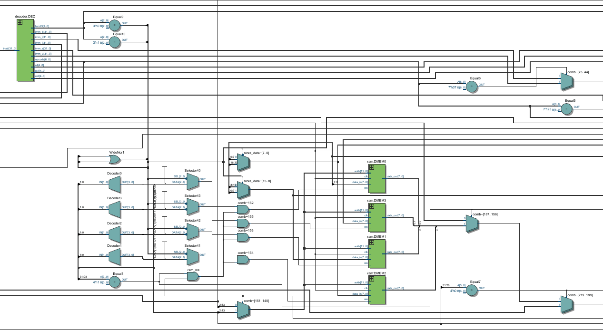</p>

*Acercamiento: el decodificador (`decoder:DEC`) saca los cinco inmediatos, y las cuatro RAM de 8 bits (`ram:DMEM0..3`) reciben cada una su byte y su habilitación de escritura para `sb`, `sh` y `sw`.*

<p align="center">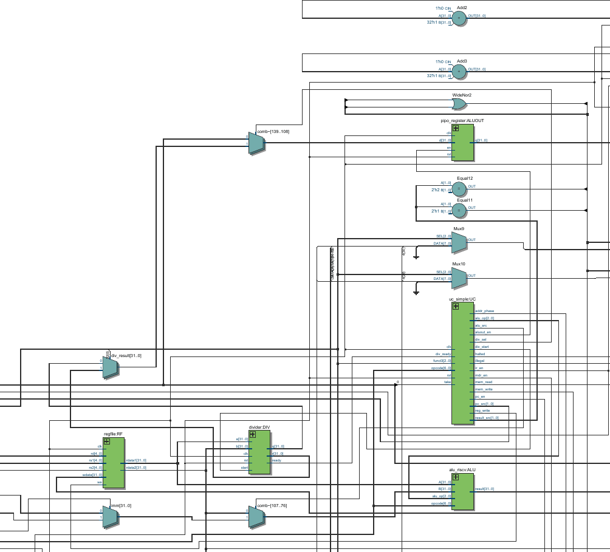</p>

*Acercamiento: banco de registros (`regfile:RF`), divisor (`divider:DIV`), unidad de control (`uc_simple:UC`) con todas sus salidas, la ALU (`alu_riscv:ALU`) y el registro `ALUOUT`.*

### 2.7 Mapa de memoria

| Dirección | Contenido |
|---|---|
| `0x0000_0000 – 0x0000_3FFF` | memoria de programa: instrucciones y, después, tablas y pesos de la red (se leen con `lw`) |
| `0x1000_0000 – 0x1000_3FFF` | memoria de datos: variables, manchas, pistas, etiquetas y pila |
| `0x2000_0000 – 0x2000_12BF` | máscara de movimiento de 80 × 60, un byte por celda (solo lectura) |
| `0xFFFF_0000` LEDS · `+04` SW · `+08` HEX · `+0C` KEY · `+10` TICKS · `+14` CONSOLA · `+18` CONTROL · `+24` PLATAFORMA | periféricos básicos |
| `0xFFFF_0040` CAM_SAL · `+44` CAM_ENT · `+48` VIS_CTRL · `+4C` VIS_EST · `+50` VIS_FG | cámara (SCCB por software) y visión |
| `0xFFFF_0054` ZONA · `+58` LINEA · `+5C` LETRERO · `+60..+7C` CAJA0..7 · `+80` COLORES | lo que se dibuja sobre el video |

`TICKS` es un contador de ciclos: con él el programa mide cuánto tarda (no hacen falta registros
especiales dentro del procesador).

<p align="center">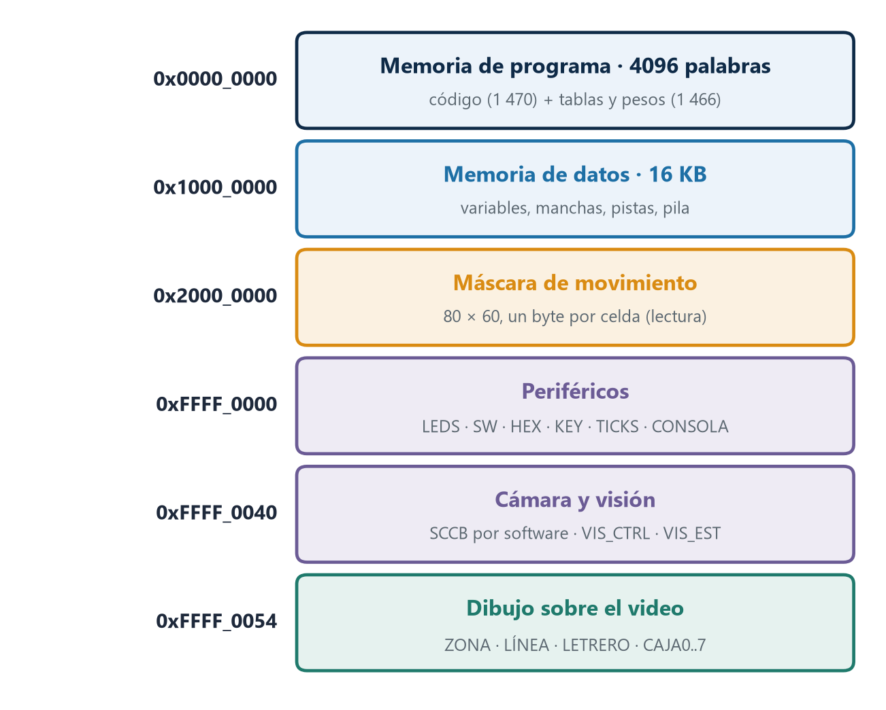</p>

*Mapa de memoria: programa, datos, máscara de movimiento y registros de entrada y salida.*

### 2.8 Los programas: de Verilog a un `.txt` en hexadecimal

Los programas se escriben **en Verilog**, con funciones que codifican cada instrucción bit a bit según su
formato (`prog/codificador_riscv.vh`: `ADD(rd, rs1, rs2)`, `LW(rd, rs1, inm)`, `XNOR(...)`, `CPOP(...)`).
Un generador de dos pasadas resuelve las etiquetas y `tb/generar_rom.v` escribe el archivo que lee la
memoria de programa, una instrucción por renglón con su comentario:

```
ffff0437 // 00000000: lui x8, 0xffff0
100004b7 // 00000004: lui x9, 0x10000
...
0015229b // 000002bc: sltiu x5, x10, 1
```

| Archivo | Programa | Instrucciones |
|---|---|---|
| `docs/base-clase/programa_ab_c.txt` | `(a + b) · c`, el de la clase | 2 |
| `fpga/programa_demo.txt` | Fibonacci en los displays y un LED que corre | 37 |
| `fpga/programa_red.txt` | clasificador 3 × 3 con los interruptores | 86 |
| `fpga/programa_isa.txt` | prueba de todas las instrucciones | 178 |
| `fpga/programa_vigia.txt` | vigilancia perimetral (el que arranca en la placa) | 1 470 |

**El procesador corre cualquier programa.** Con la placa ya grabada, `cargar_programa.tcl` detiene el
procesador, escribe otro `.txt` en la memoria de programa por el cable USB-Blaster y lo suelta en la
dirección 0, sin volver a compilar en Quartus:

```powershell
quartus_stp -t cargar_programa.tcl programa_demo.txt
```

### 2.9 Los bloques por dentro (RTL Viewer)

**El sistema completo.** `soc_neura32` une el procesador con la visión, los periféricos, el cargador por JTAG y los
registros que el programa usa para dibujar sobre el video.

<p align="center">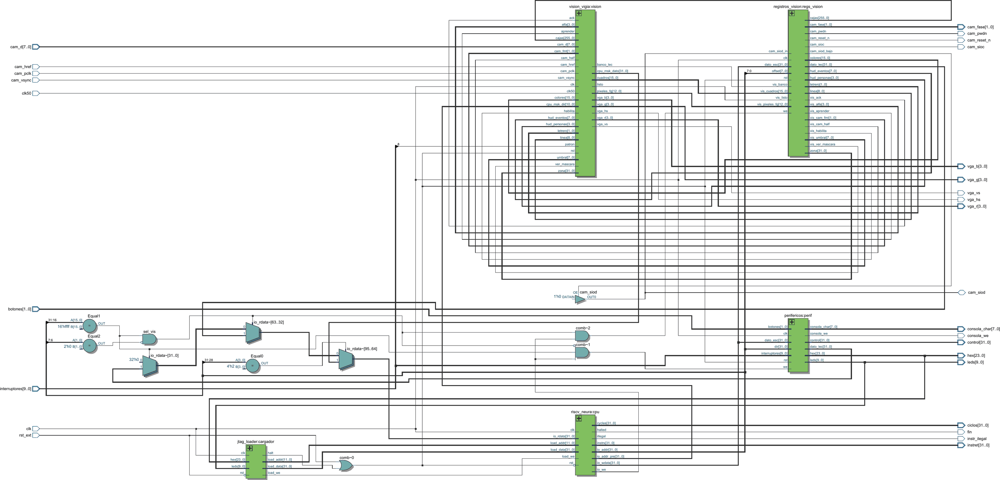</p>

*`soc_neura32` en el RTL Viewer: `riscv_neura:cpu`, `vision_vigia:vision`, `registros_vision:regs_vision`, `perifericos:perif` y `jtag_loader:cargador`, con el bus de entradas y salidas que los une.*

**`cpop` en hardware.** Dentro de la ALU, `cpop` es un árbol de sumadores: suma los bits de dos en dos, luego de cuatro en
cuatro, y así hasta tener la cuenta de 0 a 32 en 9 bits. Es lo que vuelve a la red neuronal 2.46 veces más rápida.

<p align="center">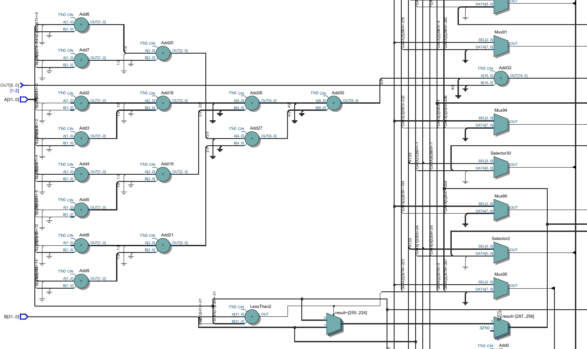</p>

*Acercamiento a la ALU: el árbol de sumas de `cpop` (`Add2` … `Add30`, salida `OUT[8..0]`) y, abajo, el comparador de `slt`.*

<p align="center">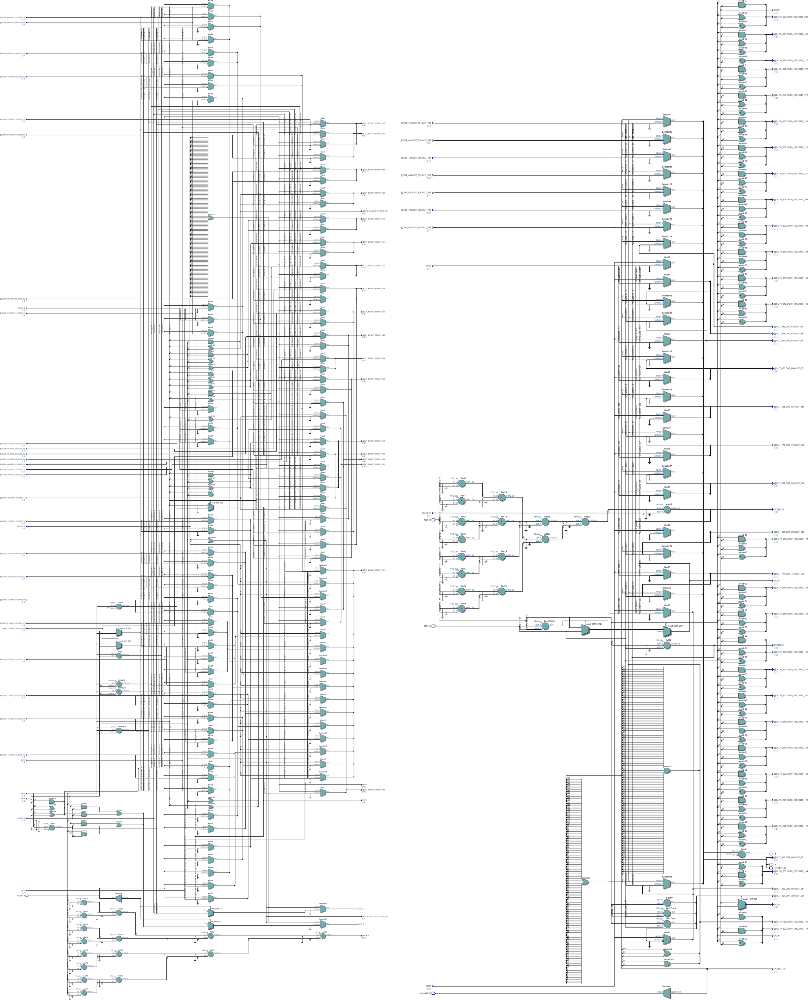</p>

*`alu_riscv` completa (dos páginas del RTL Viewer): las tres tablas de 8 operaciones y los multiplexores que escogen el resultado según el opcode y el `funct3`.*

**El divisor.** Resta y corre un bit por ciclo; un contador de 6 bits lleva la cuenta de las 32 vueltas y `ready` avisa a
la unidad de control que ya puede pasar a `WRITEBACK`.

<p align="center">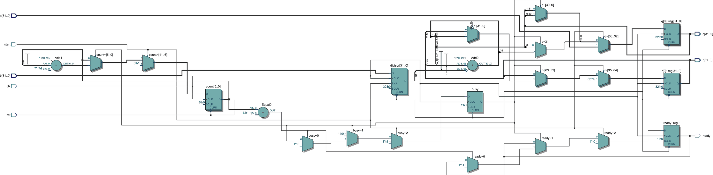</p>

*`divider` en el RTL Viewer: registros del divisor, cociente y residuo, el contador y las banderas `busy` y `ready`.*

## 3. La visión (hardware, sin procesador)

```
 OV7670 ──► cam_capture ──brillo──► memoria Y (320 × 240, 6 bits) ───────────────┐
 320 × 240     │    └─────color───► memoria UV (160 × 120, 5 + 5 bits) ──────────┤
 YUV 4:2:2     │                                                                 ▼
 ~31 cuadros/s ├──brillo──► block_avg (80 × 60) ──► fondo_mascara ──┬──► vga_draw ──► VGA 640 × 480
               │                                   F += (I − F)/2^α │      ▲
               │                         máscara (2 bancos) ──► procesador │ zona, línea, recuadros,
               └──► pc_view ──► JTAG ──► PC                        └───────┘ letreros (registros)
```


<p align="center">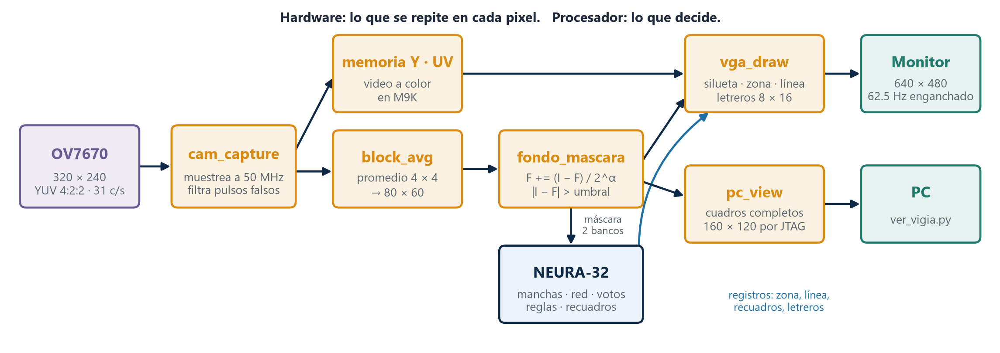</p>

*Todo lo que se repite en cada pixel es hardware; el procesador solo lee la máscara y escribe lo que se dibuja.*

1. **Cámara.** La FPGA le da el reloj (XCLK de 25 MHz, con fase ajustable) y el programa la configura por
   SCCB: 320 × 240, YUV 4:2:2, PLL × 4 y preescala entre 2, que dan PCLK de 12.5 MHz y unos **31 cuadros por
   segundo** (los 30 nominales del sensor son con 24 MHz; con los 25 MHz de la placa salen 31).
2. **Captura** (`cam_capture.v`). PCLK, HREF, VSYNC y los 8 datos se muestrean con el reloj de 50 MHz (4
   muestras por periodo de PCLK) a través de dos flip-flops; un detector de flanco marca cada byte. Así no
   hay cruces de reloj sin sincronizar. Separa el brillo (Y) de cada pixel y el color (U, V) de cada pareja.
3. **Promedio por bloques** (`block_avg.v`). Cada celda de la rejilla de 80 × 60 es el promedio de un
   bloque de 4 × 4 pixeles: baja la resolución y quita el ruido del sensor.
4. **Fondo y máscara** (`fondo_mascara.v`). Guarda un fondo aprendido F por celda y lo actualiza con un
   promedio exponencial F ← F + (I − F)/2^α. Una celda es silueta si |I − F| supera un umbral. Donde hay
   alguien parado el fondo aprende cuatro veces más lento, para que una persona quieta no se «borre». La
   máscara se escribe en dos bancos: la cámara llena uno mientras el procesador lee el otro.
5. **Monitor** (`vga_sincronia.v`, `vga_draw.v`). 640 × 480 a 62.5 Hz (784 × 510 ciclos), justo dos cuadros del
   monitor por cada cuadro de la cámara. El barrido se engancha a la cámara: el renglón 0 se escribe cuando el
   monitor va en su renglón 16, así el monitor nunca lee el renglón que se está escribiendo y no hay cortes
   aunque la cámara se mueva. La captura (`cam_capture.v`) ignora pulsos falsos de VSYNC y HREF: VSYNC cuenta solo si dura más de 5 µs y un renglón termina solo tras 300 ns de HREF en bajo, así el ruido de los cables no revuelve la imagen. Al ampliar 320 × 240 a 640 × 480 promedia cada pixel con sus vecinos (un
   renglón guardado en una M9K), así la imagen no se ve en bloques. Convierte YUV a RGB con sumas y
   corrimientos y trama el resultado (2 × 2) para el DAC de 4 bits de la placa. Encima dibuja el contorno de
   la silueta de cada persona, la línea virtual, la zona prohibida, hasta ocho recuadros con su letrero
   (`PERSONA` en verde, `INTRUSO` en rojo, `OBJETO` en gris, con una fuente de 8 × 16), el letrero grande de
   alarma y una barra de estado con las personas a la vista y los eventos.
6. **Vista en la PC** (`pc_view.v`, `fpga/ver_vigia.py`). Cuando no hay monitor, el mismo video sale por el
   cable USB-Blaster (JTAG): cuadros completos de 160 × 120 tomados de un solo banco (sin entrelazar), con la
   máscara y los recuadros, y una ventana en la
   computadora dibuja lo mismo que el monitor.

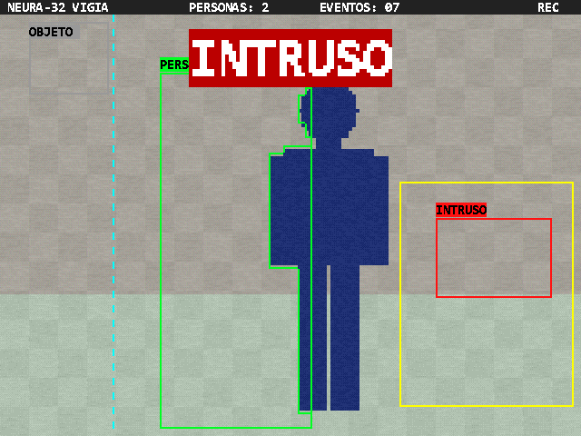

*Cuadro del monitor VGA en la simulación de la visión (`tb_vision`). Aquí no hay procesador: el banco de
pruebas escribe recuadros fijos para probar cada capa de dibujo (video a color, barra de estado, recuadros
con letrero, contorno de la silueta, zona, línea y letrero de alarma).*

## 4. El programa de vigilancia

`prog/programa_vigia.vh`, comentado instrucción por instrucción.

### 4.1 Flujo

1. **Arranque.** Reinicia la cámara, lee su identificación por SCCB (PID = 0x76, VER = 0x73; si no responde
   lo avisa en los displays) y le escribe su tabla de registros. El SCCB está hecho **por software**: el
   procesador mueve las líneas SIOC y SIOD a través de un registro.
2. **Medición y autoprueba de la red.** Clasifica una silueta guardada con `xnor` + `cpop` y otra vez
   contando los bits con instrucciones básicas, y mide los ciclos de cada una con `TICKS`. Después
   clasifica tres siluetas de referencia (cuerpo completo, medio cuerpo y busto): las tres deben salir
   «persona».
3. **Exposición fija y fondo.** A los 2 s congela la exposición, la ganancia y el balance de blancos (si
   cambian solos, todo el cuadro parece moverse) y aprende el fondo vacío.
4. **Por cada máscara** (31 veces por segundo):
   * **Etiquetado** de manchas (componentes conexos de 4 vecinos) con relleno por inundación y pila en RAM;
     el recuadro de cada mancha sale de `min` y `max`.
   * **Recorte** de cada mancha a 16 × 32 bits: ventana 1:2 centrada en el recuadro, muestreada con
     acumuladores (sin dividir).
   * **Red binaria** (4.2).
   * **Voto entre cuadros.** Cada mancha se empareja con su pista (la más cercana, distancia Manhattan con
     `abs`). La pista suma un voto cada cuadro en que la red dice «persona» y pierde uno cuando dice otra
     cosa; con 2 votos la persona queda **confirmada**. Un cuadro mal clasificado ya no hace parpadear el
     letrero ni dispara una alarma.
   * **Reglas** (solo personas confirmadas): cruzar la línea cuenta una entrada o una salida, y en el sentido
     prohibido es alarma; tener los pies dentro de la zona tres cuadros seguidos es alarma de intrusión.
     Cada evento se guarda en un registro en RAM con el cuadro y el ciclo.
   * **Salidas:** recuadros y letreros, zona, línea, barra de estado, LED y displays.
5. **Cámara movida.** Si cambia más de la mitad de la imagen tres cuadros seguidos, no es una persona:
   movieron la cámara o cambió la luz. El programa olvida las pistas, deja que la cámara vuelva a medir la
   exposición y aprende el fondo otra vez, sin dar alarma.

### 4.2 La red neuronal binaria

| Capa | Tamaño | Operación en el procesador |
|---|---|---|
| Entrada | 16 × 32 = 512 bits | la silueta recortada, en 16 palabras |
| Oculta | 64 neuronas binarias | `cuenta = Σ cpop(xnor(x, w))` sobre 16 palabras; `a = cuenta ≥ T` |
| Salida | 3 clases | `o_k = B_k + Σ W_kj` para las neuronas activas (pesos de 8 bits); el mayor gana (`sgt`) |

Los pesos de la capa oculta son de **un bit**, así que cada neurona se resuelve con `xnor` (tabla `OP_R2`)
y `cpop` (tabla `OP_R3`). La red se entrenó fuera del procesador (`sw/entrenar_vigia.py`) con 12 000
siluetas sintéticas generadas en la misma rejilla de 80 × 60 y recortadas con la misma aritmética entera
del programa, con los errores típicos de una máscara real (bordes comidos, huecos, sombra en los pies). Las
personas se generan de tres maneras: **cuerpo completo** (40 %), **medio cuerpo** (30 %) y **busto**, es
decir cabeza y hombros como en una foto tamaño infantil (30 %); en las dos últimas la persona está cerca
de la cámara y el borde de la imagen o un mueble la corta. Entre los objetos hay formas parecidas a
propósito (cajas apiladas, pantallas sobre un poste, pelotas, muebles pegados al borde). Los pesos entran
a la memoria de programa como un archivo Verilog (`prog/pesos_vigia.vh`).

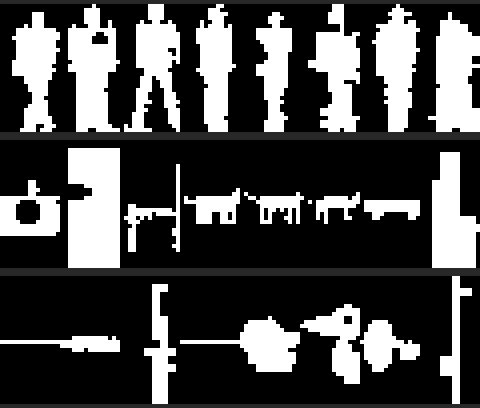

*Ejemplos: personas de cuerpo completo, de medio cuerpo y busto (tres primeros renglones), objetos y
animales (cuarto) y ruido (quinto).*

Resultado con aritmética entera, que es lo que ejecuta el procesador, sobre 1 800 siluetas de prueba:
**91.6 % de aciertos**.

| real \ predicha | persona | objeto o animal | ruido |
|---|---|---|---|
| persona | **573** | 13 | 14 |
| objeto o animal | 19 | **524** | 57 |
| ruido | 8 | 40 | **552** |

| Personas reconocidas (400 siluetas nuevas de cada tipo) | |
|---|---|
| cuerpo completo | 92.8 % |
| medio cuerpo | 96.0 % |
| busto | 95.8 % |


<p align="center">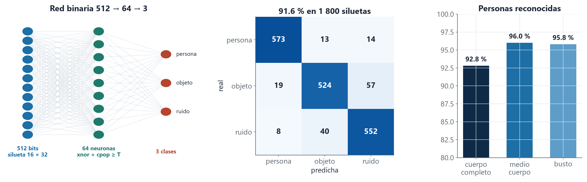</p>

*La red binaria: 512 bits de entrada, 64 neuronas que solo usan `xnor` y `cpop`, y 3 clases. Al centro, la matriz de confusión con aritmética entera; a la derecha, los tres tamaños de persona.*

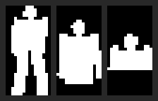

*Las tres siluetas guardadas en la memoria de programa que el procesador clasifica al arrancar: cuerpo
completo, medio cuerpo y busto. En la simulación imprime `AUTOPRUEBA DE LA RED: PERSONAS=3 DE 3`.*

## 5. Verificación

Todo se simula con Icarus Verilog (`simular.ps1` o `simular.sh`) y compila sin errores ni advertencias en
el compilador de Active-HDL. Cada banco de pruebas se revisa solo y termina con `PRUEBAS: n  ERRORES: 0`;
las salidas completas están en `tb/*.txt`.

| Banco de pruebas | Qué comprueba | Resultado |
|---|---|---|
| `tb_programa_ab_c` | el programa original de la clase, sin cambiarlo: `x4 = 12`, `x5 = 60` | 3 / 3 |
| `tb_uc_simple` | el recorrido de la máquina de estados y las señales de cada fase, por tipo de instrucción | 28 / 28 |
| `tb_prueba_isa` | las 49 instrucciones: las tres tablas, inmediatos, cargas y almacenamientos por byte, los seis saltos, subrutinas, división entre cero, lectura de tablas | 64 / 64 |
| `tb_red_neuronal` | clasificador 3 × 3 en las 16 combinaciones de prueba contra un modelo de referencia | 481 / 481 |
| `tb_cargador` | se carga otro programa por JTAG con el procesador ya corriendo | 7 / 7 |
| `tb_vision` | cámara a color, máscara, monitor enganchado sin cortes y lo que baja a la PC | 11 / 11 |
| `tb_vigia` | el sistema completo con un modelo de la cámara (5.1) | 31 / 31 |

<p align="center">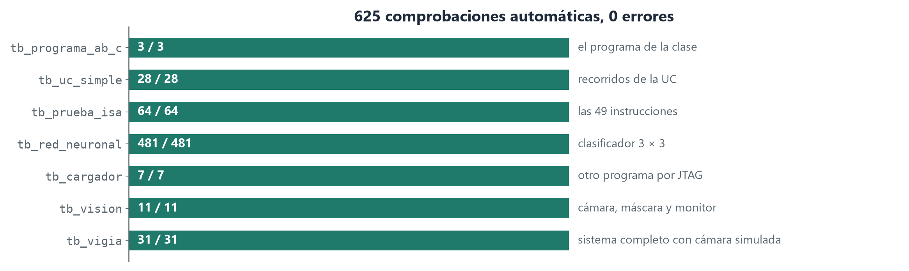</p>

*Los siete bancos de pruebas: todos se revisan solos y terminan sin errores.*

El programa de la clase, ciclo por ciclo, en el procesador final (`tb_programa_ab_c`):

```
  ciclo 0  DECODE     PC=00000004  IR=00208233  resultado=0
  ciclo 1  EXEC_R     PC=00000004  IR=00208233  resultado=0
  ciclo 2  WRITEBACK  PC=00000004  IR=00208233  resultado=12
  ciclo 3  FETCH      PC=00000004  IR=00208233  resultado=12
  ciclo 4  DECODE     PC=00000008  IR=023212b3  resultado=12
  ciclo 5  EXEC_R     PC=00000008  IR=023212b3  resultado=12
  ciclo 6  WRITEBACK  PC=00000008  IR=023212b3  resultado=60
```

### 5.1 El sistema completo con la cámara simulada

`tb/modelo_ov7670.v` imita a la cámara: responde por SCCB (escritura y lectura de registros, PID y VER),
genera PCLK con la fórmula que se midió en la cámara real (XCLK × PLL / (2 × (CLKRC + 1))), respeta el
orden de bytes y genera una escena sintética a color con textura, piso y ruido de sensor. En simulación
la cámara entrega 160 × 120 en lugar de 320 × 240 para que la prueba no dure horas; la detección es de
80 × 60 en ambos casos y el programa es exactamente el mismo.

Guion: arranque → **mueven la cámara** (todo el fondo cambia) → **un perro** cruza la zona → **una persona**
entra, cruza la línea en el sentido prohibido y se queda en la zona.

```
=== NEURA-32 VIGIA: sistema completo con camara OV7670 simulada ===
ROM: 2936 palabras (codigo 1470, tablas y pesos 1466)
NEURA-32 VIGIA: vigilancia perimetral
CAMARA PID=76 VER=73
CAMARA CONFIGURADA
RED BINARIA  CON CPOP=00838E CICLOS  SIN CPOP=0143AB CICLOS
AUTOPRUEBA DE LA RED: PERSONAS=3 DE 3
EXPOSICION FIJA
FONDO APRENDIDO: VIGILANDO
[  96.60 ms] arranque listo: cuadro 6, 11 escrituras y 2 lecturas SCCB
[  96.66 ms] escena: CAMARA MOVIDA (cambia todo el fondo)
CAMARA MOVIDA: APRENDO EL FONDO
EXPOSICION FIJA
FONDO APRENDIDO: VIGILANDO
[ 256.52 ms] camara movida: fondo aprendido 1 vez, 0 celdas de silueta, 0 eventos
[ 256.52 ms] escena: PERRO cruzando de derecha a izquierda
[ 592.23 ms] escena: PERSONA entrando por la izquierda
ENTRADA ID=01 CUADRO=002F
INTRUSO: CRUCE PROHIBIDO ID=01 CUADRO=002F
INTRUSO: EN ZONA ID=01 CUADRO=0032
cuadros procesados=58  manchas persona=21  no persona=15  eventos=3
entradas=1 salidas=0 alarma=00000031  en zona=1  manchas=1
red binaria: con cpop=33678 ciclos, sin cpop=82859 ciclos (aceleracion x2.46)
ciclos del ultimo cuadro=249392  maximo=251942  (un cuadro de la camara simulada = 399648 ciclos)
puntuaciones del ultimo recorte: programa (200, -348, -404)  referencia (200, -348, -404)
registro de eventos:
   tipo 1  id 1  cuadro 47
   tipo 3  id 1  cuadro 47
   tipo 4  id 1  cuadro 50
  ok    camara identificada: PID = 0x76
  ok    camara identificada: VER = 0x73
  ok    SCCB: CLKRC = 0x01 y PLL x4 (31 cuadros/s)
  ok    SCCB: la camara quedo en 320 x 240 (aqui 160 x 120)
  ok    SCCB: TSLB = 0x04 (orden Y U Y V)
  ok    SCCB: COM8 = 0xE0 (exposicion fija)
  ok    red: silueta de prueba = persona en las 2 versiones
  ok    red: con cpop mas rapida que contando por software
  ok    red: cuerpo completo, medio cuerpo y busto = persona
  ok    camara movida: se volvio a aprender el fondo
  ok    camara movida: el fondo nuevo ya no sale como silueta
  ok    camara movida: ni eventos ni alarma
  ok    perro: ningun evento
  ok    perro: sin alarma
  ok    perro: clasificado como no persona
  ok    persona: 1 entrada contada
  ok    persona: 0 salidas
  ok    persona: alarma activa
  ok    persona: motivo intrusion en zona
  ok    persona: motivo cruce prohibido
  ok    eventos: entrada, cruce y zona
  ok    persona: 1 persona en la zona
  ok    voto entre cuadros: 1 persona confirmada a la vista
  ok    monitor: letrero INTRUSO parpadeando
  ok    monitor: recuadro rojo sobre la persona
  ok    displays: entradas 01, salidas 00, zona 1, manchas 1
  ok    red: puntuacion = referencia Verilog
  ok    red: puntuacion = referencia Verilog
  ok    red: puntuacion = referencia Verilog
  ok    tiempo real: cabe en un cuadro de la placa (800 000 ciclos)
  ok    sin instrucciones que no existan
instrucciones=5558959 ciclos=23483842 CPI=4.22
PRUEBAS: 31  ERRORES: 0
```

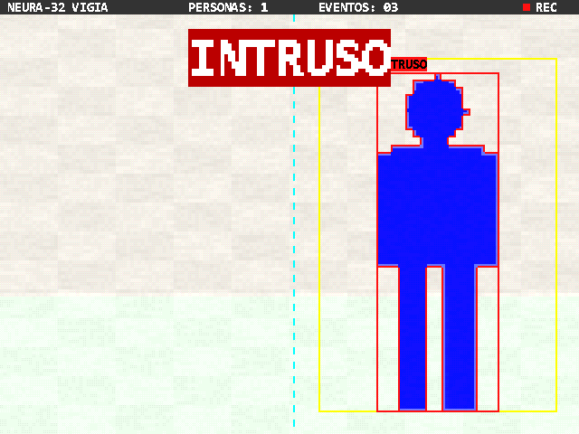

*Cuadro del monitor al final de `tb_vigia`, con lo que escribió el procesador: la persona dentro de la zona
(borde amarillo), recuadro rojo, letrero de alarma, 1 persona y 3 eventos en la barra de estado. La silueta
sale en azul porque en esta prueba SW3 está arriba.*

### 5.2 En la placa

Con la DE10-Lite y la cámara conectadas se comprobó, con el diseño de prueba `fpga/prueba_camara`: el
cableado de las 16 señales, la respuesta de la cámara por SCCB (PID = 0x76, VER = 0x73), la relación entre
XCLK y PCLK, la ventana de imagen (registros HSTART, HSTOP, VSTRT, VSTOP) y la fase de XCLK que deja la
imagen sin rayas. Esos ajustes están en `prog/ajustes_camara.txt`, que es de donde sale la tabla que el
programa le escribe a la cámara.

<p align="center">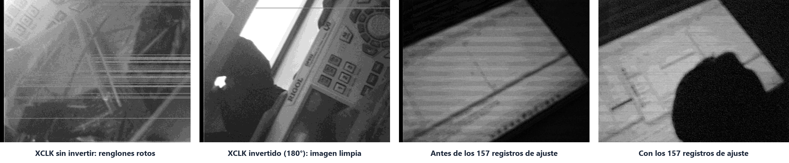</p>

*Capturas reales de la cámara en la DE10-Lite, leídas por JTAG con `fpga/prueba_camara`. Izquierda: con XCLK sin invertir se rompen los renglones; con XCLK a 180° la imagen sale limpia. Derecha: antes y después de escribir los 157 registros de ajuste.*

Después, con el diseño completo grabado en la memoria flash de la placa, la cámara entregó 31 cuadros por segundo y el
monitor se mantuvo enganchado a ella, sin cortes al mover la cámara.

## 6. Mediciones de recursos y rendimiento

### 6.1 Rendimiento

| Programa | Instrucciones | Ciclos | Ciclos por instrucción |
|---|---|---|---|
| `(a + b) · c` de la clase | 2 | 8 | 4.00 |
| Prueba de todas las instrucciones | 198 | 924 | 4.66 (incluye divisiones de 36 ciclos) |
| Clasificador 3 × 3 (una inferencia) | 2 632 | 10 782 | 4.09 |
| Vigía, simulación completa | 5 558 959 | 23 483 842 | 4.22 |

<p align="center">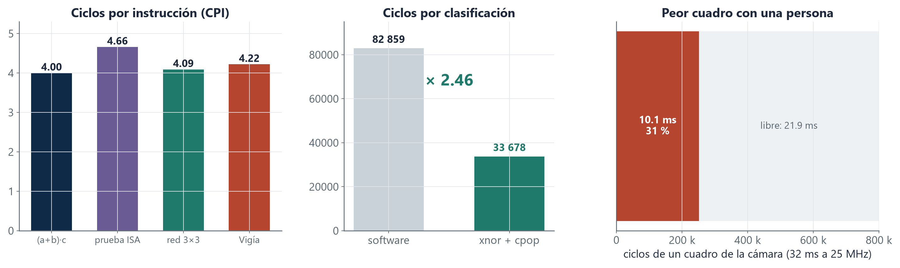</p>

*Izquierda: ciclos por instrucción de cada programa. Centro: la red neuronal con y sin `cpop`. Derecha: el peor cuadro con una persona ocupa el 31 % del tiempo entre dos cuadros de la cámara.*

**La red binaria con y sin `cpop`** (misma silueta, medido por el propio programa con `TICKS`):

| Versión | Por palabra de 32 bits | Ciclos por clasificación |
|---|---|---|
| contando los bits por software (`xor`, `xori`, corrimientos, `and`, sumas y `mul`) | 17 instrucciones | 82 859 |
| con `xnor` + `cpop` | 5 instrucciones | 33 678 |

Agregar `cpop` a la tabla `OP_R3` hace la red **2.5 veces más rápida**: es el mejor ejemplo de por
qué conviene tener más de 8 operaciones.

**Tiempo real.** La cámara entrega un cuadro cada 32 ms, que a 25 MHz son 800 000 ciclos. Procesar una
máscara con una persona (etiquetar, recortar, clasificar, votar, reglas y dibujar) toma
251 942 ciclos como máximo, 10.1 ms: el procesador multiciclo usa el 31 % del
tiempo de cada cuadro y la respuesta llega en el cuadro siguiente.

### 6.2 Recursos en la MAX 10 (Quartus Prime 24.1 Lite)

| Recurso | Usado | Disponible |
|---|---|---|
| Elementos lógicos | 9 292 (19 %) | 49 760 |
| Registros | 4 062 | |
| Bloques de memoria M9K | 164 (90 %) | 182 |
| Bits de memoria | 1 214 976 (72 %) | 1 677 312 |
| Multiplicadores de 9 bits | 6 | 288 |
| Pines | 121 | 360 |
| Frecuencia máxima del reloj de 25 MHz (modelo lento, 85 °C) | 33.57 MHz | se necesitan 25 MHz |

<p align="center">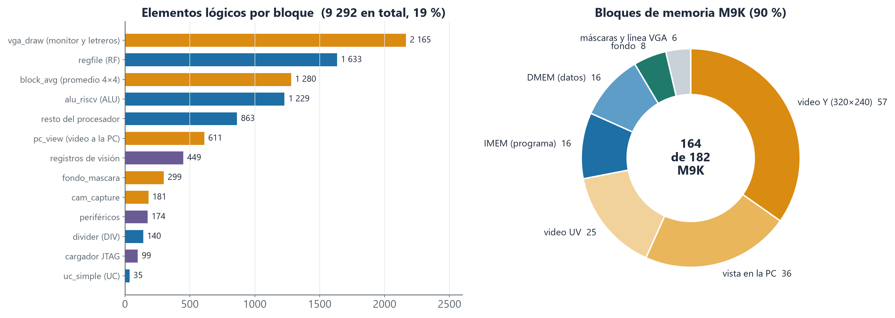</p>

*Recursos por bloque según el reporte del Fitter de Quartus. La lógica se reparte entre el monitor, el banco de registros, el promedio de la visión y la ALU; la memoria es casi toda video.*

La memoria es lo que más se ocupa: el video (brillo y color), las dos copias que se mandan a la PC, el
fondo, las máscaras, las 4096 palabras de programa y las 4096 de datos.

## 7. Conclusiones y trabajo futuro

* El procesador de la clase alcanzó para una aplicación real sin cambiarle la forma: sigue siendo
  multiciclo, con los mismos bloques, y el programa `(a + b) · c` todavía corre en él. Lo que cambió fue
  cuántas cosas sabe hacer cada bloque.
* Mantener `funct3` en 3 bits y repartir las operaciones en varios opcodes del mismo tipo (`OP_R1`,
  `OP_R2`, `OP_R3`) dejó una ALU fácil de leer: un `case` del opcode y adentro un `case` de 8 operaciones.
  Agregar una operación es agregar un renglón.
* Las instrucciones nuevas se justifican midiendo: `xnor` y `cpop` hacen la red 2.5 veces más
  rápida, y con `min`, `max`, `abs` y `sgt` el programa de vigilancia cabe en el tiempo de un cuadro aunque
  cada instrucción tarde 4 ciclos.
* Repartir el trabajo entre hardware y programa fue la decisión que lo hizo posible: lo que se repite por
  cada pixel (captura, promedio, fondo, máscara, monitor) es hardware; lo que decide (manchas, red, votos,
  reglas) es programa y se puede cambiar cargando otro `.txt`.
* Trabajo futuro: un clasificador con más neuronas para distinguir entre varias personas juntas, guardar
  la foto del evento en una memoria externa y resolver los saltos un ciclo antes para bajar los ciclos por
  instrucción.

---

## Cómo se usa

### Simulación

```powershell
pwsh -File simular.ps1            # todos los bancos (tb_vigia tarda cerca de una hora)
pwsh -File simular.ps1 -Rapido    # todos menos el sistema completo
pwsh -File simular.ps1 -Pruebas tb_prueba_isa
```

Primero escribe los `.txt` de instrucciones (`fpga/programa_*.txt`) y después corre cada banco; la salida de
cada uno queda en `tb/<banco>.txt`. En Git Bash se usa igual `bash simular.sh [banco ...]`.

En Active-HDL, con el workspace `Lab_Arquitecturas` abierto:
`do ".../Proyecto-Final-NEURA32/activehdl/agregar_diseno.do"` agrega el diseño, compila y corre el programa
de la clase. Después: `simular_ab_c.do`, `simular_uc.do`, `simular_isa.do`, `simular_red.do` o
`simular_vigia.do`.

### Placa DE10-Lite

```powershell
pwsh -File fpga\compilar.ps1          # compila y deja RESUMEN.txt con recursos y frecuencia
pwsh -File fpga\compilar.ps1 -Grabar  # además programa la placa por USB-Blaster
```

| Control | Función |
|---|---|
| KEY0 | reinicio |
| KEY1 | borra la alarma |
| SW1..SW0 | zona y línea (4 configuraciones) |
| SW2 | sentido prohibido: 0 izquierda→derecha, 1 al revés |
| SW3 | pinta toda la máscara de movimiento en azul |
| SW4 | red sin `cpop` (para comparar la velocidad) |
| SW7..SW5 | umbral de movimiento: 28 + 8 × valor |
| SW8 | barras de colores en el monitor (prueba el VGA sin cámara) |
| SW9 | vuelve a aprender el fondo mientras está arriba |
| LEDR9 / LEDR8 / LEDR7 / LEDR6 | alarma (parpadea) / aprendiendo el fondo / cámara identificada / un cuadro procesado |
| HEX5-4 / HEX3-2 / HEX1 / HEX0 | entradas / salidas / personas en la zona / manchas |

Ver el video en la computadora (sin monitor) y cargar otro programa, desde la carpeta `fpga`:

```powershell
python ver_vigia.py
```

```powershell
quartus_stp -t cargar_programa.tcl programa_demo.txt
```

La guía de conexión y arranque paso a paso está en [docs/PRUEBA-EN-PLACA.md](docs/PRUEBA-EN-PLACA.md).

### La cámara

**Modelo:** OV7670 **sin FIFO**, módulo de 18 pines (cabezal 2 × 9), alimentación de 3.3 V, salida paralela de
8 bits y configuración por SCCB. Sensor de 656 × 488 pixeles (640 × 480 útiles), pixel de 3.6 µm, hasta 30
cuadros por segundo a resolución completa, salida YUV 4:2:2 o RGB. No sirve la versión con FIFO AL422 (24
pines): la memoria de video ya está en los bloques M9K.

**Conexión a la DE10-Lite:** el conector GPIO (JP1) es de 3.3 V. La cámara se alimenta del **pin 29 (3.3 V)**;
nunca del pin 11 (5 V), que la quema.

| OV7670 | JP1 | GPIO | OV7670 | JP1 | GPIO |
|---|---|---|---|---|---|
| 3V3 | pin 29 | — | GND | pin 30 | — |
| SIOC | pin 1 | GPIO[0] | SIOD | pin 2 | GPIO[1] |
| VSYNC | pin 3 | GPIO[2] | HREF | pin 4 | GPIO[3] |
| PCLK | pin 5 | GPIO[4] | XCLK | pin 6 | GPIO[5] |
| D7 | pin 7 | GPIO[6] | D6 | pin 8 | GPIO[7] |
| D5 | pin 9 | GPIO[8] | D4 | pin 10 | GPIO[9] |
| D3 | pin 13 | GPIO[10] | D2 | pin 14 | GPIO[11] |
| D1 | pin 15 | GPIO[12] | D0 | pin 16 | GPIO[13] |
| RESET | pin 17 | GPIO[14] | PWDN | pin 18 | GPIO[15] |

**Distancia.** El lente del módulo da un campo de visión de unos 22° en horizontal y 16° en vertical. Una
persona de 1.75 m de pie cabe completa a unos **6 m**; a unos 3 m se ve de medio cuerpo y a menos de 2 m
solo el busto, y la red reconoce los tres casos. La cámara debe quedar fija (el fondo se aprende con la
cámara quieta; si se mueve, el programa lo vuelve a aprender) y el enfoque se ajusta girando el lente.

## Estructura

| Carpeta | Contenido |
|---|---|
| `docs/base-clase/` | el RISC-V de la clase, punto de partida (sin cambios) |
| `hdl/` | el procesador (`riscv_neura`, `uc_simple`, `alu_riscv`, `decoder`, `regfile`, `rom`, `ram`, `pipo_register`, `divider`), periféricos, cargador y el sistema completo |
| `hdl/vision/` | captura de la cámara, promedio, fondo y máscara, memorias, monitor VGA, vista en la PC y registros |
| `prog/` | ensamblador en Verilog, programas, pesos de las redes y ajustes de la cámara |
| `tb/` | bancos de prueba, modelo de la cámara, modelo del JTAG y generador de los `.txt`; salidas en `tb/*.txt` |
| `fpga/` | proyecto de Quartus para la DE10-Lite, los programas en `.txt`, el cargador y el visor de la PC |
| `activehdl/` | macros para Active-HDL |
| `sw/` | entrenamiento de las redes, fuente de letras, tabla de la cámara y visor |
| `docs/` | guía de prueba en la placa e imágenes |

## Referencias

1. A. Waterman y K. Asanović (eds.), *The RISC-V Instruction Set Manual, Volume I: Unprivileged ISA*, RISC-V International.
2. D. A. Patterson y J. L. Hennessy, *Computer Organization and Design RISC-V Edition*, Morgan Kaufmann, 2.ª ed., 2020.
3. Terasic, *DE10-Lite User Manual*, 2022.
4. OmniVision, *OV7670/OV7171 CMOS VGA CameraChip Implementation Guide* y hoja de datos del OV7670.
5. M. Rastegari, V. Ordonez, J. Redmon y A. Farhadi, «XNOR-Net: ImageNet Classification Using Binary Convolutional Neural Networks», *ECCV*, 2016.
6. Y. Umuroglu *et al.*, «FINN: A Framework for Fast, Scalable Binarized Neural Network Inference», *FPGA '17*, 2017.
7. M. Rodríguez-Gómez *et al.*, «FPGA Implementation for Real-Time Background Subtraction Based on Horprasert Model», *Sensors*, 2012.
